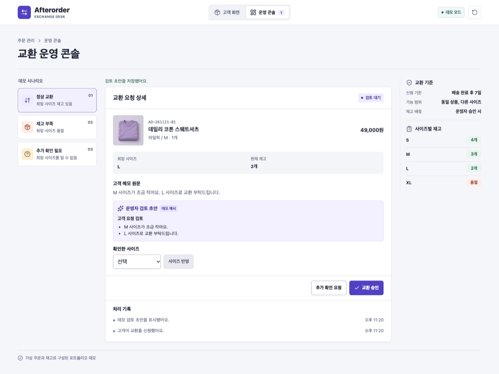

# Afterorder · 사이즈 교환 요청부터 처리까지

고객이 교환을 신청하고, 운영자가 메모와 주문을 확인해 승인하면 고객이 결과를 다시 확인하는 데모다. 커머스 UI 운영 경험과 상담 업무시스템에서 정리한 접수·상태 관리 방식에서 출발했다. 데모의 소스와 데이터는 새로 만들었으며 실제 고객 정보, 회사 코드, 운영 주소는 사용하지 않는다.



## 실행

Node.js 22.16 이상이 필요하다.

```sh
npm ci
npm run dev
```

[http://127.0.0.1:4177](http://127.0.0.1:4177)에서 열 수 있다. 프로덕션 모드로 실행하려면 `npm run build` 후 `npm start`를 실행한다.

| 시나리오 | 고객 입력 | 운영 콘솔 |
| --- | --- | --- |
| 정상 교환 | L 요청 | 승인 시 L 재고 1개 배정 |
| 재고 부족 | XL 요청 | 접수 내역은 남지만 승인할 수 없음 |
| 추가 확인 필요 | “한 사이즈 큰 걸로 바꿔주세요” | 희망 사이즈를 확정하지 않음. 확인 요청을 기록하거나 운영자가 값을 확인 후 반영 |

## 무엇을 서버에서 처리했나

- 배송 완료일부터 7일 이내인지, 같은 상품의 다른 사이즈인지 확인한다.
- 같은 주문을 여러 번 제출해도 기존 요청을 돌려준다. 승인 시 재고를 다시 조회하고, 상태 변경과 재고 차감을 같은 SQLite 트랜잭션에서 처리한다.
- 고객과 운영 콘솔이 같은 요청 상태를 사용한다. 새로고침해도 서버가 실행 중인 한 내역이 유지되며, 브라우저 세션별로 데이터가 분리된다.

## AI가 맡는 범위

초안 영역에는 고객 메모에서 근거가 되는 원문만 표시한다. 모델이 있는 경우 문장 번호를 고르게 한 뒤 서버가 그 번호를 검사하고 원문으로 복원한다. 희망 사이즈와 재고는 주문·신청 데이터로 판단하며, AI 출력으로 승인하거나 재고를 변경하지 않는다. 별도 인증 서비스나 실제 메시지·결제 연동은 없다.

기본 실행에서는 **모델 호출 없이** 예시가 표시된다. 선택적으로 서버에 `LIVE_AI=1`, `OPENAI_API_KEY`, `OPENAI_MODEL`을 모두 주면 내장 예시 문구에 한해 [Chat Completions API](https://developers.openai.com/api/docs/api-reference/chat/create)를 사용한다. 환경을 직접 설정하거나 `.env.example`을 참고하여 `.env`를 만든 뒤 `node --env-file=.env --import tsx server/index.ts --dev`로 시작한다. 사용자 작성 메모는 모델에 보내지 않으며, 모델 오류 시 화면에서 데모 예시로 돌아왔음을 알린다. 브라우저에 키를 노출하지 않는다. 기본 테스트는 실제 API를 호출하지 않는다.

## 검증

```sh
npm run build
npm test
npx playwright install chromium
npm run test:browser
```

서버 규칙, 중복 접수·승인, 재고 변경, 세션 분리, AI 근거 검사와 브라우저의 세 가지 흐름을 검증한다. 데이터 저장소는 메모리 SQLite여서 서버 재시작 시 초기화된다. 운영자 화면도 데모 방문자가 전환해 보는 역할로, 실제 관리자 인증이나 상용 배포를 가정하지 않았다.
